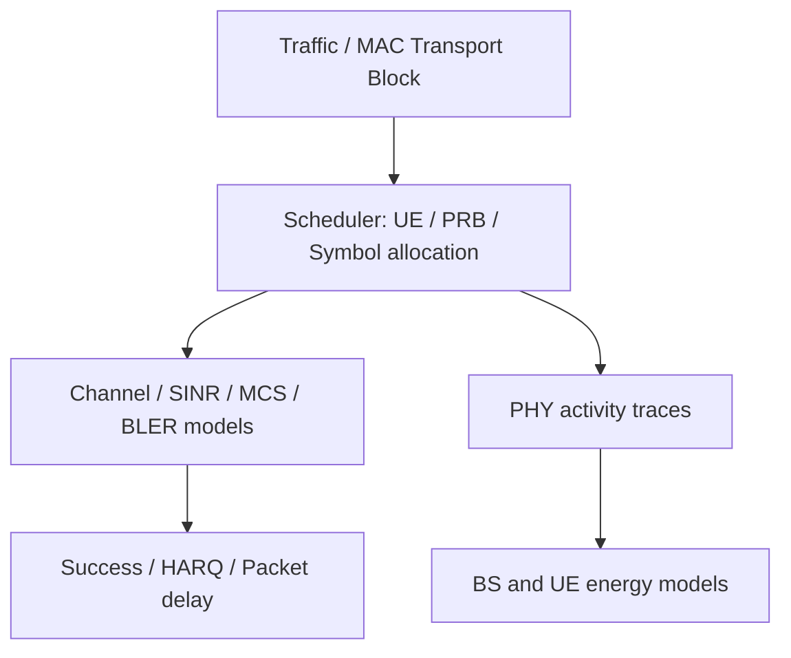
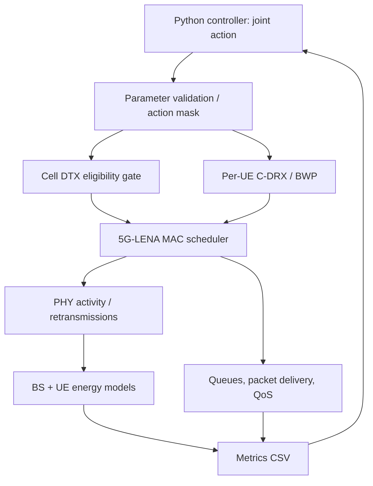

# 5G-Advanced Cell DTX × UE C-DRX/BWP：研究構想、文獻查核與可重現 MVP

> 更新：2026-10-13　｜　狀態：研究提案與工程規劃（非已完成之實驗）  
> 目的：整理研究問題、3GPP 標準限制、已知相關研究、開源實作、MVP、Baseline 與待驗證事項。  
> **閱讀約定**：「已確認」代表已從指定論文/專案的可見內容查得；「待驗證」代表尚未作端到端 source audit 或模擬驗證；「建議」代表研究設計提案，不是標準要求。

[TOC]

---

## 0. 核心結論（Executive Summary）

1. **研究題目可行，但新穎性不是「首次讓 Cell DTX 與 UE C-DRX 對齊」**。3GPP 和 Zhang et al. (2023) 已討論 alignment、不同參數對節能與 QoS 的影響。
2. 較可辯護的研究問題是：**在 3GPP 合法週期與重疊限制下，對多個異質 UE 聯合選擇 Cell DTX 以及每個 UE 的 C-DRX/BWP，以降低 BS 能耗，同時滿足 per-UE QoS ≥99% 與 UE 能耗不增加。**
3. 若只做 DL，**Cell DTX** 是直接對應的 cell-level 機制；**Cell DRX** 主要涉及接收/UL，第一階段應固定或排除其最佳化，避免目標和模擬範圍不一致。
4. **Decision、Enforcement、Measurement 是三件事**：演算法產生 DTX/DRX/BWP 設定；MAC/PHY 模擬真的執行時序限制；能耗模型再根據活動與低功率狀態計算 BS/UE 能耗。
5. 公開的 [TU Dortmund gNB Energy Model](https://github.com/tudo-cni/ns3-gNB-energy-model) 提供實際 PHY load → power accounting 與可由外部切換的 energy state；**已檢查 README、原始碼與 demo，未見它將狀態接到 Rel-18 Cell DTX 排程限制**。不能把 energy-state 切換等同 Cell DTX。
6. 三個月目標應先放在 **small-scale exhaustive search 驗證 joint optimization 有無實質收益**，接著再考慮 HRL；若沒有性能差距，應調整題目，而不是先硬做 HRL。

---

## 1. 研究題目與 SPEC

### 1.1 暫定題名

**QoS-Constrained Hierarchical Reinforcement Learning for Joint Cell DTX and UE C-DRX/BWP Configuration in 5G-Advanced Networks**

中文：**以具服務品質約束之階層式強化學習聯合最佳化 5G-Advanced Cell DTX 與使用者設備 C-DRX/BWP 配置**。

> 題名中的 HRL 是預計方法，不應預先當作已證明的貢獻；若實際只採用 sequential conditional policies，而沒有跨時間尺度 options，應評估是否改稱 hierarchical joint policy。

### 1.2 系統設定

| 項目 | 暫定 SPEC | 說明 / 待決定 |
|---|---|---|
| 網路 | Single gNB, Multi UE | MVP 先 2–3 UE，再擴至 5/10/20 UE |
| 流向 | Downlink only | 第一版最佳化 Cell DTX，非完整 Cell DTX/DRX |
| 決策 | 每個 episode/observation window 一次性聯合決策 | 固定一段時間後再評估，不必一開始做 online control |
| Cell action | DTX enable、cycle、active duration、offset | 僅允許 3GPP 定義的合法參數組合 |
| 每 UE action | C-DRX long cycle、on-duration、offset、BWP | inactivity timer 等可先固定，後續擴充 |
| QoS | **每 UE** deadline satisfaction ≥ 99% | 必須定義 packet deadline；補充 P95/P99 delay、throughput |
| UE 能耗 | 每 UE 能耗不高於 reference | Reference 建議使用 UE-only optimized、Cell DTX off |
| Objective | 最小化 BS energy | 不只是 minimizing active time |
| Baselines | 3GPP heuristic / Mao-style / Boutiba-style / independent / joint exhaustive / flat DRL | 詳見第 6 節 |

### 1.3 核心研究問題

> 在一個 gNB 服務多 UE、且流量/QoS 異質的情境下，能否在符合 Cell DTX–UE C-DRX 週期及 Active Time 重疊規範時，聯合選擇 cell 與每個 UE 的參數，使基地台能耗下降，同時每個 UE 的 QoS ≥ 99%，且各 UE 的能耗不增加？

數學化：

$$
\min_{\pi}\;\mathbb E[E_{\mathrm{BS}}^{\pi}]
$$

$$
\begin{aligned}
Q_i^{\pi}&\ge 0.99, &&\forall i\\
E_{\mathrm{UE},i}^{\pi}&\le E_{\mathrm{UE},i}^{\mathrm{ref}}, &&\forall i\\
a&\in\mathcal A_{\mathrm{3GPP\ valid}}.
\end{aligned}
$$

其中 $Q_i$ 建議定義為「UE $i$ 在 deadline 內成功完成的封包數 ÷ 到達封包數」，而非混用為 throughput 保留率。多個 traffic seeds 下應評估置信區間與 constraint violation。

**重要**：高負載下可能不存在同時滿足 99% QoS、每 UE 不增耗、Cell DTX 啟用的配置。應允許 `Cell DTX off` 作為合法 fallback，並衡量 feasibility ratio。

---

## 2. 3GPP Alignment：標準規定了什麼、沒有規定什麼？

### 2.1 週期與 Active Time

- **Cell DTX/DRX 與 UE C-DRX 是各自的配置對象**；週期與 on-duration 不必完全相同。
- 對齊有 **cycle 倍數關係與 active-duration overlap** 等規範限制（查核時請以對應版本 3GPP TS 38.300 / TS 38.331 原文為準）。
- 這些是**合法性與協作要求**，不是「自動找到最佳參數」的演算法。
- **Alignment ≠ Joint Optimization**：即使時序合法重疊，也可能有封包排隊、有限傳輸容量、額外 delay，甚至 UE 耗電增加。

概念範例（非標準逐符號圖）：Cell Active 0–10 ms / 40 ms；某 UE DRX On-duration 5–15 ms。二者重疊 5 ms，但多 UE 同時競爭時，是否滿足 deadline 仍需 scheduler 與 queue 模型驗證。

### 2.2 TR 38.864 V18.1.0 已經做過參數比較

3GPP [TR 38.864 §6.1.4.2](https://itecspec.com/3gpp/38.864/s/6.1.4.2) 的 Cell DTX/DRX 與 UE C-DRX alignment 評估，已對不同 UE DRX 組態、gNB active windows、traffic 與 baseline 比較節能、UPT 與 latency。Zhang (2023) 引述 **0.2%–71.4% 節能增益**，原始來源是 TR 38.864，而不是 Zhang 自己提出聯合最佳化演算法。

**提醒**：跨設備廠商的百分比採用不同 baseline、負載與功率模型，不能直接以一列數字當作本研究的 ground truth。此前對 MediaTek、OPPO、Intel、CATT 個別配置及 UPT/latency 的整理屬於先前查閱的報告摘要；正式引用數字前，務必回看 TR 原始 Table 6.1.4.2-1、版本與註腳。

**標準分析能支撐的研究動機**：多種合法 alignment 組態的 BS 節能、QoS 和 UE 功耗表現差異很大，值得在異質多 UE 下進行受限聯合配置。**不能支撐的說法**：「標準沒研究參數配置」或「此前沒人做 alignment」。

---

## 3. 相關論文與 Research Gap

| 文獻 | 已處理的問題 | 與本題差異 |
|---|---|---|
| [Zhang et al. (2023)](https://doi.org/10.1145/3638884.3638954) | UE–network 協同節能技術總覽；明確建議多 UE DRX patterns 與 Cell DTX/DRX 對齊；引用 TR 38.864 的對齊增益 | 未提出本題完整的 joint DRX/BWP optimization 演算法 |
| [Boutiba & Ksentini (2023)](https://doi.org/10.1109/ICC45041.2023.10279727) | UE C-DRX + BWP 的 DRL / delay–UE-energy trade-off | Rel-18 Cell DTX 非其聯合最佳化主要變數 |
| [Mao et al. (2025 預印本；後續會議版)](https://arxiv.org/abs/2507.21385) | Cell DTX/DRX 控制、BS energy 與 QoS；DQN / contextual bandit 類方法 | 未證實其同時聯合選擇每 UE C-DRX/BWP |
| [TR 38.864 (2023)](https://itecspec.com/3gpp/38.864/s/6.1.4.2) | 多種 alignment 參數、節能與性能的評估 | 不等同通用、per-UE QoS/energy constrained joint optimizer |
| [WO2024105651A1](https://patents.google.com/patent/WO2024105651A1/en) | 根據 Cell DTX 配置多 UE DRX 的時序對齊構想 | 專利先前技術；必須避免主張「首次提出多 UE alignment」 |

### 3.1 Zhang et al. (2023) 全文查核

使用本對話已上傳的 `3638884.3638954.pdf`（8 頁）。

- **第 6 頁，§3.1.1**：建議透過 gNB 將多個 UE 的 DRX patterns 與 Cell DTX/DRX 對齊，而非隨意逐 UE 配置。
- 同節引用 3GPP TR 38.864 報告不同情境的 alignment 節能增益 **0.2%–71.4%**。
- **第 5 頁，§2.2.1**：BWP 被作為 UE 節能技術討論，但未與 Cell DTX、C-DRX 組成本文的聯合最佳化方法。
- **第 8 頁，Conclusion**：明確指出節能與 user experience 的 trade-off，以及 UE energy saving 與 network energy saving 之間的 trade-off。這可以支援研究動機，但不能單憑此斷言所有其他論文都沒解決問題。

### 3.2 較穩妥的 Research Gaps

**Gap 1 — Joint Cell–UE Configuration**  
已知文獻分別聚焦 cell-level DTX/DRX 或 UE-level C-DRX/BWP，且對齊技術已有先前研究；在目前查核的研究中，尚未確認有完整聯合選擇 cell 與每 UE 參數的方法。

**Gap 2 — Optimization *under* Alignment Constraints**  
3GPP 提供合法周期/重疊限制與不同組態評估，但不直接給出面對異質 UE traffic 與 QoS demand 的最優配置政策。

**Gap 3 — Joint BS/UE Energy and Per-UE QoS Constraints**  
將 **BS energy minimization、每 UE 能耗不增、每 UE deadline satisfaction ≥99%** 放在同一 optimization problem；不同配置是否存在可行解須實證。

> **建議英文定位**：*Joint Cell DTX and per-UE C-DRX/BWP configuration under 3GPP alignment constraints, heterogeneous per-UE QoS, and non-increasing UE energy consumption.*  
> **不得宣稱**「全球第一篇／無人研究」；只能說「目前已查核文獻中尚未確認完整對應方法」，需要持續追新論文與專利。

---

## 4. ns-3 / 5G-LENA：要理解到哪個層級？

### 4.1 不需要自己生成 IQ 波形

5G-LENA 是 **system-level NR simulator**，通常不逐 bit 生成完整的 QAM/OFDM IQ waveform、LDPC decoder 與 RF receiver。典型抽象路徑為：



需要理解的是 **Frame / Slot / OFDM Symbol 時序、PRB、BWP、PDCCH/PDSCH、MAC scheduler、queue/HARQ、energy states**；不需要自己實作 FFT、QAM mapping、LDPC coding。

### 4.2 三個層次不能混用

| 層次 | 做什麼 | 在研究中的角色 |
|---|---|---|
| **Decision** | 選 Cell DTX 和 per-UE DRX/BWP 參數 | 研究演算法（Heuristic、Exhaustive、HRL） |
| **Enforcement** | MAC/PHY 依 Cell DTX Non-active、UE DRX sleep 限制新傳資料與監聽/排程 | 必須正確，否則 QoS 不可信 |
| **Measurement** | 根據 Tx/Idle/Sleep/PRB/Symbol 活動計算 BS/UE energy + delay | 必須有獨立功率模型，不能單憑 duty cycle 推論節能 |

`沒有 DL data allocation` **不等於** `基地台已切換至 sleep power state`。同理，只有 DRX **power accounting** 不等於 UE 真的停止 PDCCH monitoring 和下行排程。

### 4.3 MVP 最小資料流程



---

## 5. 開源 GitHub/GitLab 盤點（最新可用線索）

| 專案 | 連結 | 可借用內容 | 實作限制／查核狀態 |
|---|---|---|---|
| **TU Dortmund gNB Energy Model** | [GitHub](https://github.com/tudo-cni/ns3-gNB-energy-model) | gNB slot-load power accounting、symbol/channel/carrier shutdown、deep dormancy，helper、tests、demo | **已讀 README 與核心檔**；未見 Rel-18 Cell DTX MAC enforcement；只有 BS model |
| **5G-LENA 官方 NR** | [GitLab](https://gitlab.com/cttc-lena/nr) | 多 UE、scheduler、BWP、QoS / traffic、NR PHY abstraction | 需要明確核對版本與 DRX/BWP 動態可控介面 |
| **5G-LENA Energy Framework MR !408** | [GitLab](https://gitlab.com/cttc-lena/nr/-/merge_requests/408) | NR gNB/UE energy、UE DRX energy modeling | Merge Request 狀態與與官方版本相容性待核對；不等同 Cell DTX enforcement |
| **NrEnergyHelper MR !417** | [GitLab](https://gitlab.com/cttc-lena/nr/-/merge_requests/417) | 簡化 energy models 安裝 | 需要審核是否可和選定版本編譯 |
| **Orange ns-O-RAN-flexric** | [GitHub](https://github.com/Orange-OpenSource/ns-O-RAN-flexric) | Cell on/off、deep sleep、xApp 控制概念 | 尚未逐函式確認真正 scheduler gate；非 Rel-18 periodic Cell DTX |
| **DRILL-Q 5G-LENA** | [GitHub](https://github.com/mye280c37/drill-q-5g-lena) | RL MAC scheduler、delay/QoS 實驗架構 | 非 Cell DTX；相容性與官方 code 細節需 audit |
| **5G V2V Energy Simulator** | [GitHub](https://github.com/gti-uvigo/v2v-energy-sim) | ns-3/5G-LENA 能耗分析與可重現管線的參考 | 主要是 V2V 情境，非 Rel-18 Cell DTX |

### 5.1 TU Dortmund repository：這次最明確的 code evidence

專案 README 說明：

- 以 **ns-3.46 + 5G-LENA v4.1.1** 開發測試。
- 提供 `src/model/nr-gnb-energy-model.{cc,h}`、`src/helper/nr-gnb-energy-model-helper.{cc,h}`、`examples/energy-model-demo.cc`、tests。
- 從 `NrGnbPhy::GenerateAllocationStatistics()` 的 `SlotDataStats` 取得 slot-level DL load。README 建議在 5G-LENA 的 `nr-gnb-phy.cc` 過濾 UL allocation，以免錯算成 DL load。
- 提供 `SetAllBwpsExternalState()`、`SetExternalAauState()` 等外部能耗狀態控制 API；demo 透過 `Simulator::Schedule()` 在特定時間切換 Channel/Carrier Shutdown、Deep Dormancy。
- 預設功率參數（README）：`BasePowerRatio=0.22`、`BasebandPowerRatio=0.16`；`ReferencePower=0` 時輸出 normalized power，若設定為正數可用 Watts 模型。
- 8 項 unit tests；README 聲稱重現其引用 Piovesan et al. (2022) 的部分曲線/operating points（正式研究應自己跑過驗證）。

實際檢視 `nr-gnb-energy-model.cc`：有 `SlotDataStatsSink()`、`OnSlotData()`、`UpdateBwpState()`、`CheckDeepDormancy()`、symbol-load-based power calculation 與 energy state transitions。**目前沒有查到這些 energy state 會回頭阻止 MAC 下行排程**。這是 source inspection 的負面證據，不是已對所有相依檔案做完端到端 audit。

**關鍵結論**：這份 repository 非常適合用來計算 gNB energy，**不能直接當 Cell DTX controller + scheduler implementation**。其 Carrier Shutdown/Deep Dormancy 也不能直接等同 Rel-18 Cell DTX Non-active。

### 5.2 相關開源研究

- TU Dortmund 專案 README 提及 Ronschka et al. 的 MSWiM 2026 相關研究；**截至本筆記日期 2026-10-13，應核實論文正式發表狀態、全文與最終書目**。
- DRILL-Q (2025) 有與 5G-LENA / RL scheduling 相關的開源 code，但不是 cell-level power-saving protocol implementation。
- Zhang (2023) 與 Mao (2025) 在前次公開搜尋中 **未找到能確認為官方的 GitHub repository**；這不等於證明作者未公開程式碼。

---

## 6. Baselines：怎麼證明不是「只是 alignment 有效」？

| 編號 | Baseline | 研究意義 |
|---|---|---|
| B0 | Cell DTX off + 固定 UE DRX/BWP | 基礎 reference |
| B1 | 3GPP-inspired heuristic alignment | 排除「只是對齊就有效」的因素 |
| B2 | Mao-style Cell-only optimizer + 固定 UE | cell-level 節能模型基準 |
| B3 | Boutiba-style UE-only C-DRX/BWP optimizer + Cell DTX off | UE 節能與延遲基準 |
| B4 | Sequential / independently trained cell/UE optimizers | 驗證聯合決策的必要性 |
| B5 | **Joint exhaustive search（2–3 UE）** | 小規模近似/取得參數格點內的最佳值（oracle） |
| B6 | Flat joint DRL | 分離「joint optimization」與「hierarchy」的收益 |
| P | HRL / hierarchical joint policy | 預計方法 |

**公平比較原則**：同一個 simulator、能耗模型、traffic traces/seeds、channel assumptions、合法 action sets 與 QoS 定義。不應把不同論文各自報告的節能百分比直接比較。

參數例子：若 8 個 Cell actions、每 UE 4 個 actions、3 UE，共 $8\times4^3=512$ 個配置（每個配置仍需多個 simulation seeds）。小規模 exhaustive 用於先驗證 gap，不等於大規模方法。

最重要的測量：

- BS total energy (J)；BS saving vs *feasible* baselines。
- UE $i$ energy (J)，relative to reference；超標比例。
- UE $i$ deadline satisfaction、P95/P99 latency、throughput。
- Feasible-action fraction、constraint violation；high load 下 fallback。
- 訓練/搜尋成本、推論時間、UE 數擴充性。

---

## 7. 必須補的 Cell DTX 真實行為（Enforcement）

### 7.1 為什麼不能只改 Power Model？

若控制器選擇 Cell DTX 40 ms cycle、10 ms active duration，但 scheduler 仍允許 15 ms 到達的封包即刻送出：

- delay 不會因 DTX 正確增加；
- queue 不會正確累積；
- PHY 仍可能傳資料；
- energy accounting 若直接硬套 sleep power，就會得到不可信的節能結果。

因此 MVP 必須有 **Cell DTX eligibility gate**，在 scheduler 產生一般 DL 新傳資料 allocation 前，判斷當下是否處於允許的 active window，並保留封包至後續可傳時機。

### 7.2 更完整的交互作用

概念上：

$$
\mathrm{DlEligible}_i(t)=\mathrm{CellAvailable}(t)\land\mathrm{UeAwake}_i(t)
$$

但這只是骨架，不能代替完整標準規則：還需處理 UE inactivity timer、HARQ/retx、PDCCH、SSB 與特定下行訊號例外、boundary/slot mapping、BWP switching delay。**不要把所有 Cell DTX Non-active Time 等同 RF 完全關機。**

### 7.3 Code audit 的焦點

1. 5G-LENA：`NrMacSchedulerNs3` / scheduler factory / actual DL allocation path。
2. 5G-LENA：`NrGnbMac` → `NrGnbPhy` 如何交付 allocation；是否有適合的 eligibility hook。
3. `NrGnbPhy::GenerateAllocationStatistics()` → `SlotDataStats` → energy model。
4. UE DRX model 是否只改 power state，還是真正阻止 sleep 時 PDCCH monitoring / DL scheduling。
5. BWP 是否允許 per-UE episode-level 切換，及 numerology/BWP restrictions。
6. HARQ 和控制訊號例外，不應因簡單 gating 造成邏輯錯誤。

> 在 code audit 前，任何「只改幾行即可完整 Cell DTX」都只能當作假設，不是已證明的工期。

---

## 8. 三個月 Codex MVP 規劃（12 週）

| 週次 | 交付物 | 主要驗收 |
|---|---|---|
| W1–2 | 固定版本 ns-3 / 5G-LENA + gNB/UE energy + 1 BS/3 UE DL 測試；code audit | 能輸出 energy、delay；定位 Cell DTX gate 修改點（Go/No-Go） |
| W3–4 | Cell DTX eligibility + C-DRX 排程行為 | active/non-active 與 UE wake/sleep 的 slot traces 正確；queue/HARQ 不壞 |
| W5–6 | per-UE BWP、合法 action mask、99% QoS | switching 與 capacity/energy 有合理效果；多 seeds 可重現 |
| W7–8 | Heuristic / cell-only / UE-only / independent / joint exhaustive | 首張 energy–QoS frontier；判斷 joint improvement 是否存在 |
| W9–10 | Flat DRL + 初版 hierarchical joint policy | 與 exhaustive 小規模 optimum 比較 |
| W11–12 | 測試、異質流量與擴充、消融 | 固定依賴、記錄 commit、圖表與 confidence intervals |

**風險**：真正的 DRX protocol/scheduler integration、Rel-18 控制訊號例外、per-UE BWP dynamic behavior 比 Python RL 較難。若 W2 audit 未過關，就應先降低模擬粒度或修正研究範圍。

### 8.1 快速開始：黑箱化研究接口（計畫中的介面，非官方已內建）

```bash
./ns3 run "joint-energy-mvp --numUes=3 --cellDtxCycleMs=40 --cellActiveMs=10 --seed=1"
```

輸出（自行實作）：`bs_energy.csv`、`ue_energy.csv`、`packet_delay.csv`、`qos_summary.csv`。Python controller 用參數執行 C++ simulator、讀 CSV，第一階段不一定需要 ns3-gym 或即時互動。

---

## 9. 優先實驗：先確認 Joint Optimization 是否有 gap

**MVP 0：1 gNB、1 UE、固定 BWP、固定 DL traffic。**

- A：Cell always active。
- B：Cell DTX 40 ms / active 10 ms；UE DRX 暫時停用。
- 先驗證真正 non-active data gating、延遲增加與能耗狀態變化，而不是只比較 power formula。

**MVP 1：2–3 UE、多種 packet inter-arrival、deadline 與 channel quality。**

- 檢查 multi-UE 對齊時的 queue contention；
- 加入 per-UE DRX 與固定候選 BWP；
- 比較 heuristic alignment、independent/sequential 與 joint exhaustive。

**研究 Go/No-Go**：在相同 QoS/UE-energy constraints 下，joint feasible optimum 是否比 heuristic/sequential 降低 BS energy？改善是否隨 UE heterogeneity 增大？若差距很小，HRL 的必要性不足；可能需要調整問題或改用較輕量方法。

---

## 10. 待決策與驗證清單

- [ ] 從官方版本原文核對 38.300 / 38.331 Cell DTX–UE C-DRX cycle/offset/active-time constraints 與非 active 例外。
- [ ] 重新逐項核對 TR 38.864 V18.1.0 §6.1.4.2 的評估表、假設與各家公司 baseline。
- [ ] 決定 reference UE configuration（建議 UE-only optimum、Cell DTX off）。
- [ ] 決定 QoS 99% 是 deadline satisfaction，並設定不同 traffic classes 的 deadlines。
- [ ] 選定單一 ns-3/5G-LENA commit；檢查 TU Dortmund model、!408/!417 的相容性，避免直接合併兩個 energy frameworks。
- [ ] 逐函式完成 Cell DTX gate、DRX scheduling、BWP control 和 energy state 的 end-to-end audit。
- [ ] 先做 action-grid exhaustive，量測 feasibility，不要先預設 HRL 一定有效。
- [ ] 研究公開程式碼之 license（TU Dortmund GPL-2.0-only）與後續釋出策略。
- [ ] 正式提案的 novelty statement 使用「尚未在已核對文獻確認」，不使用「目前沒有人做」。

---

## 11. 文獻與程式碼連結

### 標準與論文

1. 3GPP, *TR 38.864 V18.1.0 — Study on Network Energy Savings for NR* (2023), [§6.1.4.2 參考頁](https://itecspec.com/3gpp/38.864/s/6.1.4.2)。
2. 3GPP, *TS 38.300* — Cell DTX/DRX / UE C-DRX alignment 相關條文（使用正式 3GPP 版本核對）。
3. 3GPP, *TS 38.331* — CellDTX-DRX-Config 相關 RRC 參數（使用正式版本核對）。
4. Zhang, S., et al. (2023). *Research on Power Saving Techniques in NR for Cooperation between UEs and Wireless Networks*. ICCIP 2023. https://doi.org/10.1145/3638884.3638954 （本對話已提供 8 頁 PDF）。
5. Boutiba & Ksentini (2023). UE C-DRX / BWP 最佳化相關論文。https://doi.org/10.1109/ICC45041.2023.10279727
6. Mao et al. (2025 預印本 / 後續會議版). Cell DTX/DRX 最佳化。https://arxiv.org/abs/2507.21385
7. Piovesan et al. (2022). *Machine Learning and Analytical Power Consumption Models for 5G Base Stations*. https://doi.org/10.1109/MCOM.001.2200023
8. [WO2024105651A1 — Aligning User Equipment DRX to Cell DTX](https://patents.google.com/patent/WO2024105651A1/en)（專利先前技術，不是同行審查期刊論文）。

### 原始碼 / 模擬框架

- [5G-LENA GitLab](https://gitlab.com/cttc-lena/nr)
- [TU Dortmund — ns3-gNB-energy-model GitHub](https://github.com/tudo-cni/ns3-gNB-energy-model)
- [5G-LENA Energy Framework MR !408](https://gitlab.com/cttc-lena/nr/-/merge_requests/408)
- [5G-LENA NrEnergyHelper MR !417](https://gitlab.com/cttc-lena/nr/-/merge_requests/417)
- [Orange — ns-O-RAN-flexric](https://github.com/Orange-OpenSource/ns-O-RAN-flexric)
- [DRILL-Q 5G-LENA](https://github.com/mye280c37/drill-q-5g-lena)
- [5G V2V Energy Simulator](https://github.com/gti-uvigo/v2v-energy-sim)

---

## 12. 可以交給 Codex 的第一個任務（先 Audit、不要改程式）

```text
Goal: Identify the minimum viable implementation of 3GPP Rel-18-inspired
Cell DTX enforcement for single-gNB multi-UE DL energy/QoS experiments.

Read and compare:
- https://gitlab.com/cttc-lena/nr
- https://github.com/tudo-cni/ns3-gNB-energy-model
- https://gitlab.com/cttc-lena/nr/-/merge_requests/408
- https://gitlab.com/cttc-lena/nr/-/merge_requests/417
- https://github.com/Orange-OpenSource/ns-O-RAN-flexric

Do not modify code. Cite actual file paths, functions, code line numbers,
and pinned commits. Determine:
1. Does an energy sleep state suppress new DL MAC allocations, or only
   change power accounting?
2. Where could a cell-DTX active/non-active eligibility gate be applied
   before DL scheduling with minimal impact on HARQ and control signals?
3. Is UE C-DRX really enforced for scheduling/PDCCH monitoring or only
   represented in an energy model?
4. Can we choose per-UE BWP at episode boundaries, and what limitations
   follow from numerology and current NR implementation?
5. How should real PHY activity events feed both BS and UE energy models?
6. Which tests prove no new DL data allocations in Cell-DTX non-active
   periods while packet queues and QoS remain correctly modeled?

Return a file-level feasibility matrix, dependency/compatibility report,
minimal patch plan and 2-week go/no-go test plan. Mark any unverified
claim explicitly. Avoid rewriting the entire scheduler.
```

---

**最終研究原則**：先證明 *under alignment constraints* 的 joint configuration **確實比獨立/啟發式配置有收益**，再用 HRL 解決大規模 action space；不要把 alignment、energy accounting 或 power-state transitions 誤當成完整的 Rel-18 Cell DTX scheduling implementation。
