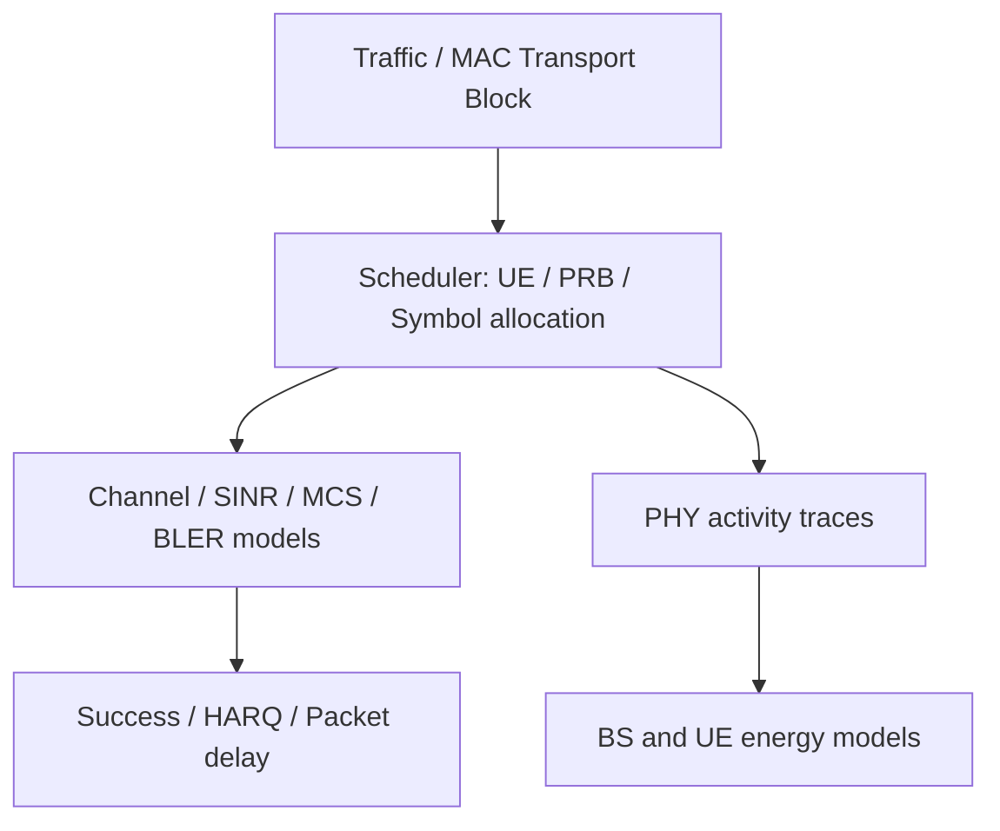
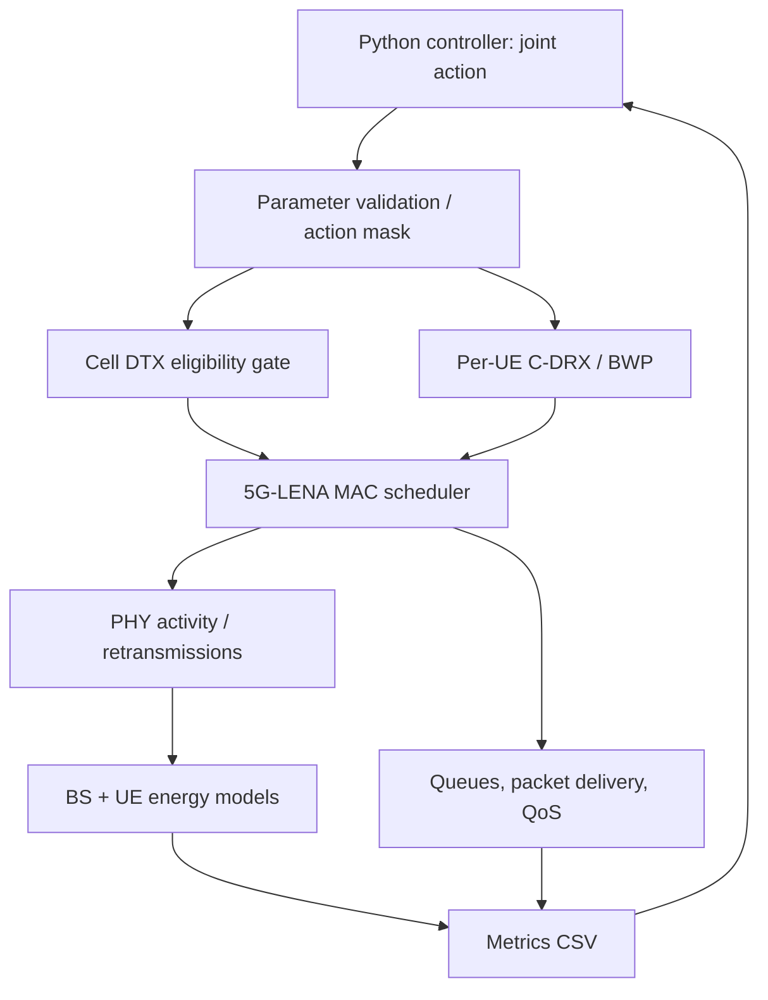

# 5G-Advanced Cell DTX × UE C-DRX/BWP：研究構想、文獻查核與可重現 MVP

> 更新：2026-10-13　｜　狀態：研究提案與工程規劃（非已完成之實驗）  
> 目的：整理研究問題、3GPP 標準限制、已知相關研究、開源實作、MVP、Baseline 與待驗證事項。  
> **閱讀約定**：「已確認」代表已從指定論文/專案的可見內容查得；「待驗證」代表尚未作端到端 source audit 或模擬驗證；「建議」代表研究設計提案，不是標準要求。

[TOC]

---

## 0. 核心結論（Executive Summary）

1. **研究題目可行，但新穎性不是「首次讓 Cell DTX 與 UE C-DRX 對齊」**。3GPP 和 Zhang et al. (2023) 已討論 alignment、不同參數對節能與 QoS 的影響。
2. 較可辯護的研究問題是：**在 3GPP 合法週期與重疊限制下，對多個異質 UE 聯合選擇 Cell DTX 以及每個 UE 的 C-DRX/BWP，以降低 BS 能耗，同時滿足 per-UE QoS ≥99% 與 UE 能耗不增加。**
3. 若只做 DL，**Cell DTX** 是直接對應的 cell-level 機制；**Cell DRX** 主要涉及接收/UL，第一階段應固定或排除其最佳化，避免目標和模擬範圍不一致。
4. **Decision、Enforcement、Measurement 是三件事**：演算法產生 DTX/DRX/BWP 設定；MAC/PHY 模擬真的執行時序限制；能耗模型再根據活動與低功率狀態計算 BS/UE 能耗。
5. 公開的 [TU Dortmund gNB Energy Model](https://github.com/tudo-cni/ns3-gNB-energy-model) 提供實際 PHY load → power accounting 與可由外部切換的 energy state；**已檢查 README、原始碼與 demo，未見它將狀態接到 Rel-18 Cell DTX 排程限制**。不能把 energy-state 切換等同 Cell DTX。
6. 三個月目標應先放在 **small-scale exhaustive search 驗證 joint optimization 有無實質收益**，接著再考慮 HRL；若沒有性能差距，應調整題目，而不是先硬做 HRL。

---

## 1. 研究題目與 SPEC

### 1.1 暫定題名

**QoS-Constrained Hierarchical Reinforcement Learning for Joint Cell DTX and UE C-DRX/BWP Configuration in 5G-Advanced Networks**

中文：**以具服務品質約束之階層式強化學習聯合最佳化 5G-Advanced Cell DTX 與使用者設備 C-DRX/BWP 配置**。

> 題名中的 HRL 是預計方法，不應預先當作已證明的貢獻；若實際只採用 sequential conditional policies，而沒有跨時間尺度 options，應評估是否改稱 hierarchical joint policy。

### 1.2 系統設定

| 項目 | 暫定 SPEC | 說明 / 待決定 |
|---|---|---|
| 網路 | Single gNB, Multi UE | MVP 先 2–3 UE，再擴至 5/10/20 UE |
| 流向 | Downlink only | 第一版最佳化 Cell DTX，非完整 Cell DTX/DRX |
| 決策 | 每個 episode/observation window 一次性聯合決策 | 固定一段時間後再評估，不必一開始做 online control |
| Cell action | DTX enable、cycle、active duration、offset | 僅允許 3GPP 定義的合法參數組合 |
| 每 UE action | C-DRX long cycle、on-duration、offset、BWP | inactivity timer 等可先固定，後續擴充 |
| QoS | **每 UE** deadline satisfaction ≥ 99% | 必須定義 packet deadline；補充 P95/P99 delay、throughput |
| UE 能耗 | 每 UE 能耗不高於 reference | Reference 建議使用 UE-only optimized、Cell DTX off |
| Objective | 最小化 BS energy | 不只是 minimizing active time |
| Baselines | 3GPP heuristic / Mao-style / Boutiba-style / independent / joint exhaustive / flat DRL | 詳見第 6 節 |

### 1.3 核心研究問題

> 在一個 gNB 服務多 UE、且流量/QoS 異質的情境下，能否在符合 Cell DTX–UE C-DRX 週期及 Active Time 重疊規範時，聯合選擇 cell 與每個 UE 的參數，使基地台能耗下降，同時每個 UE 的 QoS ≥ 99%，且各 UE 的能耗不增加？

數學化：

$$
\min_{\pi}\;\mathbb E[E_{\mathrm{BS}}^{\pi}]
$$

$$
\begin{aligned}
Q_i^{\pi}&\ge 0.99, &&\forall i\\
E_{\mathrm{UE},i}^{\pi}&\le E_{\mathrm{UE},i}^{\mathrm{ref}}, &&\forall i\\
a&\in\mathcal A_{\mathrm{3GPP\ valid}}.
\end{aligned}
$$

其中 $Q_i$ 建議定義為「UE $i$ 在 deadline 內成功完成的封包數 ÷ 到達封包數」，而非混用為 throughput 保留率。多個 traffic seeds 下應評估置信區間與 constraint violation。

**重要**：高負載下可能不存在同時滿足 99% QoS、每 UE 不增耗、Cell DTX 啟用的配置。應允許 `Cell DTX off` 作為合法 fallback，並衡量 feasibility ratio。

---

## 2. 3GPP Alignment：標準規定了什麼、沒有規定什麼？

### 2.1 週期與 Active Time

- **Cell DTX/DRX 與 UE C-DRX 是各自的配置對象**；週期與 on-duration 不必完全相同。
- 對齊有 **cycle 倍數關係與 active-duration overlap** 等規範限制（查核時請以對應版本 3GPP TS 38.300 / TS 38.331 原文為準）。
- 這些是**合法性與協作要求**，不是「自動找到最佳參數」的演算法。
- **Alignment ≠ Joint Optimization**：即使時序合法重疊，也可能有封包排隊、有限傳輸容量、額外 delay，甚至 UE 耗電增加。

概念範例（非標準逐符號圖）：Cell Active 0–10 ms / 40 ms；某 UE DRX On-duration 5–15 ms。二者重疊 5 ms，但多 UE 同時競爭時，是否滿足 deadline 仍需 scheduler 與 queue 模型驗證。

### 2.2 TR 38.864 V18.1.0 已經做過參數比較

3GPP [TR 38.864 §6.1.4.2](https://itecspec.com/3gpp/38.864/s/6.1.4.2) 的 Cell DTX/DRX 與 UE C-DRX alignment 評估，已對不同 UE DRX 組態、gNB active windows、traffic 與 baseline 比較節能、UPT 與 latency。Zhang (2023) 引述 **0.2%–71.4% 節能增益**，原始來源是 TR 38.864，而不是 Zhang 自己提出聯合最佳化演算法。

**提醒**：跨設備廠商的百分比採用不同 baseline、負載與功率模型，不能直接以一列數字當作本研究的 ground truth。此前對 MediaTek、OPPO、Intel、CATT 個別配置及 UPT/latency 的整理屬於先前查閱的報告摘要；正式引用數字前，務必回看 TR 原始 Table 6.1.4.2-1、版本與註腳。

**標準分析能支撐的研究動機**：多種合法 alignment 組態的 BS 節能、QoS 和 UE 功耗表現差異很大，值得在異質多 UE 下進行受限聯合配置。**不能支撐的說法**：「標準沒研究參數配置」或「此前沒人做 alignment」。

---

## 3. 相關論文與 Research Gap

| 文獻 | 已處理的問題 | 與本題差異 |
|---|---|---|
| [Zhang et al. (2023)](https://doi.org/10.1145/3638884.3638954) | UE–network 協同節能技術總覽；明確建議多 UE DRX patterns 與 Cell DTX/DRX 對齊；引用 TR 38.864 的對齊增益 | 未提出本題完整的 joint DRX/BWP optimization 演算法 |
| [Boutiba & Ksentini (2023)](https://doi.org/10.1109/ICC45041.2023.10279727) | UE C-DRX + BWP 的 DRL / delay–UE-energy trade-off | Rel-18 Cell DTX 非其聯合最佳化主要變數 |
| [Mao et al. (2025 預印本；後續會議版)](https://arxiv.org/abs/2507.21385) | Cell DTX/DRX 控制、BS energy 與 QoS；DQN / contextual bandit 類方法 | 未證實其同時聯合選擇每 UE C-DRX/BWP |
| [TR 38.864 (2023)](https://itecspec.com/3gpp/38.864/s/6.1.4.2) | 多種 alignment 參數、節能與性能的評估 | 不等同通用、per-UE QoS/energy constrained joint optimizer |
| [WO2024105651A1](https://patents.google.com/patent/WO2024105651A1/en) | 根據 Cell DTX 配置多 UE DRX 的時序對齊構想 | 專利先前技術；必須避免主張「首次提出多 UE alignment」 |

### 3.1 Zhang et al. (2023) 全文查核

使用本對話已上傳的 `3638884.3638954.pdf`（8 頁）。

- **第 6 頁，§3.1.1**：建議透過 gNB 將多個 UE 的 DRX patterns 與 Cell DTX/DRX 對齊，而非隨意逐 UE 配置。
- 同節引用 3GPP TR 38.864 報告不同情境的 alignment 節能增益 **0.2%–71.4%**。
- **第 5 頁，§2.2.1**：BWP 被作為 UE 節能技術討論，但未與 Cell DTX、C-DRX 組成本文的聯合最佳化方法。
- **第 8 頁，Conclusion**：明確指出節能與 user experience 的 trade-off，以及 UE energy saving 與 network energy saving 之間的 trade-off。這可以支援研究動機，但不能單憑此斷言所有其他論文都沒解決問題。

### 3.2 較穩妥的 Research Gaps

**Gap 1 — Joint Cell–UE Configuration**  
已知文獻分別聚焦 cell-level DTX/DRX 或 UE-level C-DRX/BWP，且對齊技術已有先前研究；在目前查核的研究中，尚未確認有完整聯合選擇 cell 與每 UE 參數的方法。

**Gap 2 — Optimization *under* Alignment Constraints**  
3GPP 提供合法周期/重疊限制與不同組態評估，但不直接給出面對異質 UE traffic 與 QoS demand 的最優配置政策。

**Gap 3 — Joint BS/UE Energy and Per-UE QoS Constraints**  
將 **BS energy minimization、每 UE 能耗不增、每 UE deadline satisfaction ≥99%** 放在同一 optimization problem；不同配置是否存在可行解須實證。

> **建議英文定位**：*Joint Cell DTX and per-UE C-DRX/BWP configuration under 3GPP alignment constraints, heterogeneous per-UE QoS, and non-increasing UE energy consumption.*  
> **不得宣稱**「全球第一篇／無人研究」；只能說「目前已查核文獻中尚未確認完整對應方法」，需要持續追新論文與專利。

---

## 4. ns-3 / 5G-LENA：要理解到哪個層級？

### 4.1 不需要自己生成 IQ 波形

5G-LENA 是 **system-level NR simulator**，通常不逐 bit 生成完整的 QAM/OFDM IQ waveform、LDPC decoder 與 RF receiver。典型抽象路徑為：



需要理解的是 **Frame / Slot / OFDM Symbol 時序、PRB、BWP、PDCCH/PDSCH、MAC scheduler、queue/HARQ、energy states**；不需要自己實作 FFT、QAM mapping、LDPC coding。

### 4.2 三個層次不能混用

| 層次 | 做什麼 | 在研究中的角色 |
|---|---|---|
| **Decision** | 選 Cell DTX 和 per-UE DRX/BWP 參數 | 研究演算法（Heuristic、Exhaustive、HRL） |
| **Enforcement** | MAC/PHY 依 Cell DTX Non-active、UE DRX sleep 限制新傳資料與監聽/排程 | 必須正確，否則 QoS 不可信 |
| **Measurement** | 根據 Tx/Idle/Sleep/PRB/Symbol 活動計算 BS/UE energy + delay | 必須有獨立功率模型，不能單憑 duty cycle 推論節能 |

`沒有 DL data allocation` **不等於** `基地台已切換至 sleep power state`。同理，只有 DRX **power accounting** 不等於 UE 真的停止 PDCCH monitoring 和下行排程。

### 4.3 MVP 最小資料流程



---

## 5. 開源 GitHub/GitLab 盤點（最新可用線索）

| 專案 | 連結 | 可借用內容 | 實作限制／查核狀態 |
|---|---|---|---|
| **TU Dortmund gNB Energy Model** | [GitHub](https://github.com/tudo-cni/ns3-gNB-energy-model) | gNB slot-load power accounting、symbol/channel/carrier shutdown、deep dormancy，helper、tests、demo | **已讀 README 與核心檔**；未見 Rel-18 Cell DTX MAC enforcement；只有 BS model |
| **5G-LENA 官方 NR** | [GitLab](https://gitlab.com/cttc-lena/nr) | 多 UE、scheduler、BWP、QoS / traffic、NR PHY abstraction | 需要明確核對版本與 DRX/BWP 動態可控介面 |
| **5G-LENA Energy Framework MR !408** | [GitLab](https://gitlab.com/cttc-lena/nr/-/merge_requests/408) | NR gNB/UE energy、UE DRX energy modeling | Merge Request 狀態與與官方版本相容性待核對；不等同 Cell DTX enforcement |
| **NrEnergyHelper MR !417** | [GitLab](https://gitlab.com/cttc-lena/nr/-/merge_requests/417) | 簡化 energy models 安裝 | 需要審核是否可和選定版本編譯 |
| **Orange ns-O-RAN-flexric** | [GitHub](https://github.com/Orange-OpenSource/ns-O-RAN-flexric) | Cell on/off、deep sleep、xApp 控制概念 | 尚未逐函式確認真正 scheduler gate；非 Rel-18 periodic Cell DTX |
| **DRILL-Q 5G-LENA** | [GitHub](https://github.com/mye280c37/drill-q-5g-lena) | RL MAC scheduler、delay/QoS 實驗架構 | 非 Cell DTX；相容性與官方 code 細節需 audit |
| **5G V2V Energy Simulator** | [GitHub](https://github.com/gti-uvigo/v2v-energy-sim) | ns-3/5G-LENA 能耗分析與可重現管線的參考 | 主要是 V2V 情境，非 Rel-18 Cell DTX |

### 5.1 TU Dortmund repository：這次最明確的 code evidence

專案 README 說明：

- 以 **ns-3.46 + 5G-LENA v4.1.1** 開發測試。
- 提供 `src/model/nr-gnb-energy-model.{cc,h}`、`src/helper/nr-gnb-energy-model-helper.{cc,h}`、`examples/energy-model-demo.cc`、tests。
- 從 `NrGnbPhy::GenerateAllocationStatistics()` 的 `SlotDataStats` 取得 slot-level DL load。README 建議在 5G-LENA 的 `nr-gnb-phy.cc` 過濾 UL allocation，以免錯算成 DL load。
- 提供 `SetAllBwpsExternalState()`、`SetExternalAauState()` 等外部能耗狀態控制 API；demo 透過 `Simulator::Schedule()` 在特定時間切換 Channel/Carrier Shutdown、Deep Dormancy。
- 預設功率參數（README）：`BasePowerRatio=0.22`、`BasebandPowerRatio=0.16`；`ReferencePower=0` 時輸出 normalized power，若設定為正數可用 Watts 模型。
- 8 項 unit tests；README 聲稱重現其引用 Piovesan et al. (2022) 的部分曲線/operating points（正式研究應自己跑過驗證）。

實際檢視 `nr-gnb-energy-model.cc`：有 `SlotDataStatsSink()`、`OnSlotData()`、`UpdateBwpState()`、`CheckDeepDormancy()`、symbol-load-based power calculation 與 energy state transitions。**目前沒有查到這些 energy state 會回頭阻止 MAC 下行排程**。這是 source inspection 的負面證據，不是已對所有相依檔案做完端到端 audit。

**關鍵結論**：這份 repository 非常適合用來計算 gNB energy，**不能直接當 Cell DTX controller + scheduler implementation**。其 Carrier Shutdown/Deep Dormancy 也不能直接等同 Rel-18 Cell DTX Non-active。

### 5.2 相關開源研究

- TU Dortmund 專案 README 提及 Ronschka et al. 的 MSWiM 2026 相關研究；**截至本筆記日期 2026-10-13，應核實論文正式發表狀態、全文與最終書目**。
- DRILL-Q (2025) 有與 5G-LENA / RL scheduling 相關的開源 code，但不是 cell-level power-saving protocol implementation。
- Zhang (2023) 與 Mao (2025) 在前次公開搜尋中 **未找到能確認為官方的 GitHub repository**；這不等於證明作者未公開程式碼。

---

## 6. Baselines：怎麼證明不是「只是 alignment 有效」？

| 編號 | Baseline | 研究意義 |
|---|---|---|
| B0 | Cell DTX off + 固定 UE DRX/BWP | 基礎 reference |
| B1 | 3GPP-inspired heuristic alignment | 排除「只是對齊就有效」的因素 |
| B2 | Mao-style Cell-only optimizer + 固定 UE | cell-level 節能模型基準 |
| B3 | Boutiba-style UE-only C-DRX/BWP optimizer + Cell DTX off | UE 節能與延遲基準 |
| B4 | Sequential / independently trained cell/UE optimizers | 驗證聯合決策的必要性 |
| B5 | **Joint exhaustive search（2–3 UE）** | 小規模近似/取得參數格點內的最佳值（oracle） |
| B6 | Flat joint DRL | 分離「joint optimization」與「hierarchy」的收益 |
| P | HRL / hierarchical joint policy | 預計方法 |

**公平比較原則**：同一個 simulator、能耗模型、traffic traces/seeds、channel assumptions、合法 action sets 與 QoS 定義。不應把不同論文各自報告的節能百分比直接比較。

參數例子：若 8 個 Cell actions、每 UE 4 個 actions、3 UE，共 $8\times4^3=512$ 個配置（每個配置仍需多個 simulation seeds）。小規模 exhaustive 用於先驗證 gap，不等於大規模方法。

最重要的測量：

- BS total energy (J)；BS saving vs *feasible* baselines。
- UE $i$ energy (J)，relative to reference；超標比例。
- UE $i$ deadline satisfaction、P95/P99 latency、throughput。
- Feasible-action fraction、constraint violation；high load 下 fallback。
- 訓練/搜尋成本、推論時間、UE 數擴充性。

---

## 7. 必須補的 Cell DTX 真實行為（Enforcement）

### 7.1 為什麼不能只改 Power Model？

若控制器選擇 Cell DTX 40 ms cycle、10 ms active duration，但 scheduler 仍允許 15 ms 到達的封包即刻送出：

- delay 不會因 DTX 正確增加；
- queue 不會正確累積；
- PHY 仍可能傳資料；
- energy accounting 若直接硬套 sleep power，就會得到不可信的節能結果。

因此 MVP 必須有 **Cell DTX eligibility gate**，在 scheduler 產生一般 DL 新傳資料 allocation 前，判斷當下是否處於允許的 active window，並保留封包至後續可傳時機。

### 7.2 更完整的交互作用

概念上：

$$
\mathrm{DlEligible}_i(t)=\mathrm{CellAvailable}(t)\land\mathrm{UeAwake}_i(t)
$$

但這只是骨架，不能代替完整標準規則：還需處理 UE inactivity timer、HARQ/retx、PDCCH、SSB 與特定下行訊號例外、boundary/slot mapping、BWP switching delay。**不要把所有 Cell DTX Non-active Time 等同 RF 完全關機。**

### 7.3 Code audit 的焦點

1. 5G-LENA：`NrMacSchedulerNs3` / scheduler factory / actual DL allocation path。
2. 5G-LENA：`NrGnbMac` → `NrGnbPhy` 如何交付 allocation；是否有適合的 eligibility hook。
3. `NrGnbPhy::GenerateAllocationStatistics()` → `SlotDataStats` → energy model。
4. UE DRX model 是否只改 power state，還是真正阻止 sleep 時 PDCCH monitoring / DL scheduling。
5. BWP 是否允許 per-UE episode-level 切換，及 numerology/BWP restrictions。
6. HARQ 和控制訊號例外，不應因簡單 gating 造成邏輯錯誤。

> 在 code audit 前，任何「只改幾行即可完整 Cell DTX」都只能當作假設，不是已證明的工期。

---

## 8. 三個月 Codex MVP 規劃（12 週）

| 週次 | 交付物 | 主要驗收 |
|---|---|---|
| W1–2 | 固定版本 ns-3 / 5G-LENA + gNB/UE energy + 1 BS/3 UE DL 測試；code audit | 能輸出 energy、delay；定位 Cell DTX gate 修改點（Go/No-Go） |
| W3–4 | Cell DTX eligibility + C-DRX 排程行為 | active/non-active 與 UE wake/sleep 的 slot traces 正確；queue/HARQ 不壞 |
| W5–6 | per-UE BWP、合法 action mask、99% QoS | switching 與 capacity/energy 有合理效果；多 seeds 可重現 |
| W7–8 | Heuristic / cell-only / UE-only / independent / joint exhaustive | 首張 energy–QoS frontier；判斷 joint improvement 是否存在 |
| W9–10 | Flat DRL + 初版 hierarchical joint policy | 與 exhaustive 小規模 optimum 比較 |
| W11–12 | 測試、異質流量與擴充、消融 | 固定依賴、記錄 commit、圖表與 confidence intervals |

**風險**：真正的 DRX protocol/scheduler integration、Rel-18 控制訊號例外、per-UE BWP dynamic behavior 比 Python RL 較難。若 W2 audit 未過關，就應先降低模擬粒度或修正研究範圍。

### 8.1 快速開始：黑箱化研究接口（計畫中的介面，非官方已內建）

```bash
./ns3 run "joint-energy-mvp --numUes=3 --cellDtxCycleMs=40 --cellActiveMs=10 --seed=1"
```

輸出（自行實作）：`bs_energy.csv`、`ue_energy.csv`、`packet_delay.csv`、`qos_summary.csv`。Python controller 用參數執行 C++ simulator、讀 CSV，第一階段不一定需要 ns3-gym 或即時互動。

---

## 9. 優先實驗：先確認 Joint Optimization 是否有 gap

**MVP 0：1 gNB、1 UE、固定 BWP、固定 DL traffic。**

- A：Cell always active。
- B：Cell DTX 40 ms / active 10 ms；UE DRX 暫時停用。
- 先驗證真正 non-active data gating、延遲增加與能耗狀態變化，而不是只比較 power formula。

**MVP 1：2–3 UE、多種 packet inter-arrival、deadline 與 channel quality。**

- 檢查 multi-UE 對齊時的 queue contention；
- 加入 per-UE DRX 與固定候選 BWP；
- 比較 heuristic alignment、independent/sequential 與 joint exhaustive。

**研究 Go/No-Go**：在相同 QoS/UE-energy constraints 下，joint feasible optimum 是否比 heuristic/sequential 降低 BS energy？改善是否隨 UE heterogeneity 增大？若差距很小，HRL 的必要性不足；可能需要調整問題或改用較輕量方法。

---

## 10. 待決策與驗證清單

- [ ] 從官方版本原文核對 38.300 / 38.331 Cell DTX–UE C-DRX cycle/offset/active-time constraints 與非 active 例外。
- [ ] 重新逐項核對 TR 38.864 V18.1.0 §6.1.4.2 的評估表、假設與各家公司 baseline。
- [ ] 決定 reference UE configuration（建議 UE-only optimum、Cell DTX off）。
- [ ] 決定 QoS 99% 是 deadline satisfaction，並設定不同 traffic classes 的 deadlines。
- [ ] 選定單一 ns-3/5G-LENA commit；檢查 TU Dortmund model、!408/!417 的相容性，避免直接合併兩個 energy frameworks。
- [ ] 逐函式完成 Cell DTX gate、DRX scheduling、BWP control 和 energy state 的 end-to-end audit。
- [ ] 先做 action-grid exhaustive，量測 feasibility，不要先預設 HRL 一定有效。
- [ ] 研究公開程式碼之 license（TU Dortmund GPL-2.0-only）與後續釋出策略。
- [ ] 正式提案的 novelty statement 使用「尚未在已核對文獻確認」，不使用「目前沒有人做」。

---

## 11. 文獻與程式碼連結

### 標準與論文

1. 3GPP, *TR 38.864 V18.1.0 — Study on Network Energy Savings for NR* (2023), [§6.1.4.2 參考頁](https://itecspec.com/3gpp/38.864/s/6.1.4.2)。
2. 3GPP, *TS 38.300* — Cell DTX/DRX / UE C-DRX alignment 相關條文（使用正式 3GPP 版本核對）。
3. 3GPP, *TS 38.331* — CellDTX-DRX-Config 相關 RRC 參數（使用正式版本核對）。
4. Zhang, S., et al. (2023). *Research on Power Saving Techniques in NR for Cooperation between UEs and Wireless Networks*. ICCIP 2023. https://doi.org/10.1145/3638884.3638954 （本對話已提供 8 頁 PDF）。
5. Boutiba & Ksentini (2023). UE C-DRX / BWP 最佳化相關論文。https://doi.org/10.1109/ICC45041.2023.10279727
6. Mao et al. (2025 預印本 / 後續會議版). Cell DTX/DRX 最佳化。https://arxiv.org/abs/2507.21385
7. Piovesan et al. (2022). *Machine Learning and Analytical Power Consumption Models for 5G Base Stations*. https://doi.org/10.1109/MCOM.001.2200023
8. [WO2024105651A1 — Aligning User Equipment DRX to Cell DTX](https://patents.google.com/patent/WO2024105651A1/en)（專利先前技術，不是同行審查期刊論文）。

### 原始碼 / 模擬框架

- [5G-LENA GitLab](https://gitlab.com/cttc-lena/nr)
- [TU Dortmund — ns3-gNB-energy-model GitHub](https://github.com/tudo-cni/ns3-gNB-energy-model)
- [5G-LENA Energy Framework MR !408](https://gitlab.com/cttc-lena/nr/-/merge_requests/408)
- [5G-LENA NrEnergyHelper MR !417](https://gitlab.com/cttc-lena/nr/-/merge_requests/417)
- [Orange — ns-O-RAN-flexric](https://github.com/Orange-OpenSource/ns-O-RAN-flexric)
- [DRILL-Q 5G-LENA](https://github.com/mye280c37/drill-q-5g-lena)
- [5G V2V Energy Simulator](https://github.com/gti-uvigo/v2v-energy-sim)

---

## 12. 可以交給 Codex 的第一個任務（先 Audit、不要改程式）

```text
Goal: Identify the minimum viable implementation of 3GPP Rel-18-inspired
Cell DTX enforcement for single-gNB multi-UE DL energy/QoS experiments.

Read and compare:
- https://gitlab.com/cttc-lena/nr
- https://github.com/tudo-cni/ns3-gNB-energy-model
- https://gitlab.com/cttc-lena/nr/-/merge_requests/408
- https://gitlab.com/cttc-lena/nr/-/merge_requests/417
- https://github.com/Orange-OpenSource/ns-O-RAN-flexric

Do not modify code. Cite actual file paths, functions, code line numbers,
and pinned commits. Determine:
1. Does an energy sleep state suppress new DL MAC allocations, or only
   change power accounting?
2. Where could a cell-DTX active/non-active eligibility gate be applied
   before DL scheduling with minimal impact on HARQ and control signals?
3. Is UE C-DRX really enforced for scheduling/PDCCH monitoring or only
   represented in an energy model?
4. Can we choose per-UE BWP at episode boundaries, and what limitations
   follow from numerology and current NR implementation?
5. How should real PHY activity events feed both BS and UE energy models?
6. Which tests prove no new DL data allocations in Cell-DTX non-active
   periods while packet queues and QoS remain correctly modeled?

Return a file-level feasibility matrix, dependency/compatibility report,
minimal patch plan and 2-week go/no-go test plan. Mark any unverified
claim explicitly. Avoid rewriting the entire scheduler.
```

---

**最終研究原則**：先證明 *under alignment constraints* 的 joint configuration **確實比獨立/啟發式配置有收益**，再用 HRL 解決大規模 action space；不要把 alignment、energy accounting 或 power-state transitions 誤當成完整的 Rel-18 Cell DTX scheduling implementation。

---

## 13. Per-UE 標準 BWP timer 整改順序（2026-10-25）

正式模型固定使用 `enableDciDynamic=true`。每個 UE 維護自己的 `defaultBwp=20 MHz`、`effectiveBwp`、`requestedBwp`、`pendingBwp` 與 `bwp-InactivityTimer`。BWP 切換的 reward/accounting 一律以 `effectiveBwp` 為準，不以 controller 的 requested action 代替實際狀態。

### Timer 與 action 的時間語意

一個 40 ms evaluation window 內可能發生 BWP switch。例如 window 前半段 UE 使用 100 MHz，bwp-InactivityTimer 到期後後半段回到 default 20 MHz。此時 action 只有一個（該 window 開始時的 request），但能量與 throughput 必須依實際事件切成兩段積分：

```text
E_window = P_100 * Δt_100 + P_20 * Δt_20
```

controller 需要記錄 `effectiveBwp` 的 transition timestamp；`AvgPower`、`UePower`、`J/bit`、throughput 與 reward 使用 event-segmented accounting。若 switch 尚未生效，`effectiveBwp` 保持舊值，`pendingBwp=1`，不能提前使用新 BWP 的功耗或 QoS。

### 實作順序

1. 建立 per-UE BWP state machine：`default/effective/requested/pending/timer/applied`。（第一階段已完成 state 欄位與 timeline schema；目前仍保留 immediate-switch，等待 grant hook 後才啟用 pending。）
2. 在 `NrGnbMac::DlScheduling` grant activity hook 記錄 per-UE DL scheduling activity。該 trace 提供 `RNTI、BWP ID、slot、symbol span、TB size`；目前以 `TB size > 0` 的 DL grant 作為可觀測的 gNB-side scheduling activity，不把 PHY TX 或 FlowMonitor RX 當作 timer 來源。
3. 只有該 UE 的 scheduling activity 才 restart 該 UE 的 `bwp-InactivityTimer`；aggregate queue 或 FlowMonitor RX 不得直接重設 timer。
4. timer 到期時，該 UE 回到 `default BWP=20 MHz`；移除 custom queue-based return timer。
5. 移除 custom `controllerBwpDwellMs` 與 `m_bwpDwellRemainingMs`；保留標準 switch delay、slot eligibility 與 grant-span constraints。
6. 初始化時令 UE `OnDuration` 對齊 Cell-DTX initial active window；後續 `enableDciDynamic=true` 時，active-window 更新同步更新 UE OnDuration。
7. Observation 增加 per-UE `effective/requested/pending/timer/applied` 欄位。
8. PPO action 定義為 switch request；reward 僅使用實際已套用的 `effectiveBwp` 與分段 energy/QoS。
9. 依序驗證固定 per-UE BWP、單 UE 切換、timer 獨立到期、requested/effective 不一致及 window 內兩段 energy accounting。
10. 通過底層驗證後，使用同一套 timer semantics 重新跑 static、1D、2D、grid search，最後才重訓 PPO。

### 目前進度（phase 2）

- 已加入 `bwpInactivityTimerMs` CLI 參數，預設 40 ms，與目前 40 ms controller evaluation/cycle 對齊；它與 `cdrxInactivityMs` 是不同 timer。
- 已加入 per-UE timer 剩餘時間與 requested/effective/pending 分離。controller 要求 100 MHz 時可立即套用；要求回到 20 MHz 時先記為 `pending=20`，只有 timer 到期才套用 default BWP。
- 已連接每個 physical BWP 的 `NrGnbMac::DlScheduling` trace；`PerUeBwpDlSchedulingTraceConnected=1` 的 smoke test 已通過，程式也可正常 build。
- custom dwell 與 queue-based return 尚未移除；必須先完成 timer expiry、window 內 transition trace 與 energy segmentation 驗證，再進行下一階段清理，避免把尚未驗證的 timer 行為混入正式 baseline。

### Timer expiry smoke test

固定 S5 response：第一次回覆 `UE0=100, UE1=20`，後續回覆兩者皆請求 20 MHz；traffic 在第一次 controller decision 後停止，避免新的 DL grant 重設 timer。結果：

```text
t=0.20 s: effective=100;20, requested=100;20, timer=40;0 ms
t=0.24 s: effective=20;20,  requested=20;20,  timer=0;0 ms
```

因此目前 state machine 已驗證「requested 20 不立即覆寫 effective 100；timer 到期後才回 default 20」。輸出保留於 `experiment_archive/per_ue_bwp_timer_expiry_2026-10-25/timeline2.csv`。下一步才是將同一語意擴展至 scalar 2D controller，並移除舊 custom dwell/queue return。

### Scalar 2D phase

已將 physical-BWP 的 scalar 2D path 也接到同一個 `NrGnbMac::DlScheduling` activity hook。當 `enableTrueBwp=true` 且使用 scalar 2D 時，custom dwell 不再阻擋標準 timer 的回切；只有 legacy PRB-profile 模式仍保留舊 dwell 行為。`scalar_2d_bwp_timer_smoke_2026-10-25` 已 build、啟動與結束正常，trace connection 為 1。

高負載測試 `scalar_2d_bwp_timer_highload_2026-10-25/timeline_high.csv` 顯示：threshold 設為 `Warn=0.4, High=0.5` 時，controller 可以觸發 20→100 MHz；但切換後若在下一個 40 ms window 沒有觀測到 DL grant，timer 會使它回到 20 MHz。這不是 crash，而是暴露出「切換後第一個有效 scheduling activity 是否應被視為 timer 起算事件」仍需明確定義；下一步要加入 transition/activity trace，區分真正無 grant 與 callback 尚未對應到 UE 的情況，再決定是否需要一次性的 post-switch grace window。

已加入 `timeline.csv.bwp-activity.csv` trace，欄位為 `SimTimeMs,UeId,Rnti,BwpId,TbSize,TimerBeforeMs,TimerAfterMs`。重跑結果顯示 callback 確實收到兩個 UE 的 DL scheduling activity，但在本次 physical-BWP 配置中 `BwpId` 全部為 0；因此 100 MHz request 後沒有看到 BWP 1 的 grant，timer 回切是「實際沒有觀測到 wide-BWP scheduling」的結果，不是 trace 靜默。下一步應先查明 physical BWP scheduler selection 為何仍落在 BWP 0，再做 timer behavior 的正式判定。

目前最可能的原因已縮小為：`SwitchUeToPrimaryBwp()` 只改變 UE RRC/primary BWP 與 UE energy scaling，並沒有把 gNB 端 RLC bearer、BSR/queue ownership 或 CCM routing 從 BWP 0 遷移到 BWP 1。`NrGnbMac::DlScheduling` 的 trace 不是漏記錄；它回報的是實際產生 grant 的 MAC，而目前所有實際 grant 都仍由 BWP 0 scheduler 產生。`m_currentBwp=100` 只是 controller state，不能視為 BWP 1 已經承接 bearer。這是 timer 之前必須修正的 physical-BWP routing 一致性問題。

### Routing A/B 修正結論

上述「bearer 未遷移」只是第一次觀察下的假設，已用 `enableCdrx=false` 做 A/B 修正。關閉 C-DRX 後，同一 physical-BWP routing 測試可在 `BwpId=1` 觀測到 DL grants（例如 321.5 ms 起連續出現兩個 UE 的 BWP 1 grants）。因此 BWP1 routing/CCM 並非根本缺失；原本 C-DRX 開啟時看不到 BWP1 grant，較可能是新 BWP 的 target slot 被 UE C-DRX eligibility gate 排除，而不是 trace 漏記錄。下一步要在 activity trace 同時輸出 `CellActive`、`UEActive` 與 reject reason，才能區分 C-DRX phase/OnDuration 對 BWP1 的影響。

per-BWP eligibility decision trace 已加入並重跑。最新結果在 `BwpId=1` 的 decisions 中出現 `CellActive=1, UeActive=1, Allowed=1`，同時 activity trace 也觀測到 BWP1 grants；因此目前不能把「BWP1 沒有 grant」當成固定 routing 問題。若某次 transition window 仍只有 BWP0，應以同一時間範圍的 eligibility decision trace 判斷是 slot eligibility、event ordering 或尚未完成 primary-BWP indication，而不是直接修改 timer。

### Transition trace 完成

新增 `timeline.csv.bwp-transition.csv`，記錄 `controller-request`、`controller-request-pending`、`gnb-routing-observed` 與 `timer-expiry`。gNB routing observation 延後 1 ns 取樣，以避開同一 simulation timestamp 中 RRC indication 的 event ordering。測試結果顯示：

```text
t=320 ms: request BWP 1 → gNB routing observed BWP 1
t=360 ms: request BWP 0 → gNB routing observed BWP 0
```

因此 transition trace 已能直接確認 controller request 與 gNB routing 的先後關係，不再需要從 grant trace 間接猜測。

### Phase-offset A/B validation

在 Torch CU118 terminal 1 使用相同高負載條件比較 `phaseOffsetMs=0` 與 `phaseOffsetMs=10`：

- aligned（offset=0）：BWP1 grant 156、BWP1 eligibility allowed 312。
- misaligned（offset=10）：BWP1 grant 290、eligibility allowed 581、rejected 239。
- 239 個 rejection 全部是 `ue-cdrx-inactive`，不是 Cell-DTX inactive。

這證明 transition trace 與 decision trace 可以把「BWP routing 已完成，但 UE C-DRX 不在 Active Time」和「沒有 BWP routing」區分開來。此結果也支持保留立即倒數的 timer 語意；若 target slot 沒有 UE eligibility，不能把它誤判成 BWP routing failure。

---

## 14. 重要研究記錄：BWP transition-aware observability（2026-10-25）

### 14.1 為什麼必須記錄 transition

controller 的 action 只是 request，不等於 radio 已經完成切換。若只看 controller timeline 的 `CurrentBwp=100`，可能錯誤地把尚未完成 routing、尚未通過 UE C-DRX eligibility，或尚未產生實際 grant 的區間，當成「100 MHz 已經有效運作」。

因此本研究將 BWP 狀態拆成以下事件鏈：

```text
Controller request
    → UE primary-BWP indication
    → gNB BwpManager routing update
    → scheduler eligibility decision
    → actual DL grant
    → PHY/energy activity
```

每一層都可能有不同時間點；不能以單一 action 或單一 `CurrentBwp` 欄位代替整條事件鏈。

### 14.2 三種狀態不可混用

- `requestedBwp`：controller 要求的目標 BWP。
- `effectiveBwp`：UE energy/accounting 與實際狀態所使用的 BWP。
- `gNB routing BWP`：gNB CCM/BwpManager 對該 UE DL bearer 實際選用的 BWP。

只有在 transition trace 證明 gNB routing 已更新、並且 scheduler/PHY 有相符活動後，才能將 request 視為已套用。reward、power、throughput 與 J/bit 必須使用 `effectiveBwp`，不能直接使用 requested action。

### 14.3 三份 trace 的責任分工

1. `timeline.csv`：evaluation window 的 aggregate controller state、queue、effective/requested/pending BWP。
2. `timeline.csv.eligibility-decisions.csv`：scheduler 建立 grant 前的 per-BWP decision，包含 `CellActive`、`UeActive`、`Allowed` 與拒絕原因。
3. `timeline.csv.bwp-activity.csv`：`NrGnbMac::DlScheduling` 實際建立 DL grant 的時間、UE、BWP 與 TB size。
4. `timeline.csv.bwp-transition.csv`：request、pending、gNB routing observation 與 timer expiry 的事件時間戳。

### 14.4 transition trace 的判讀規則

```text
有 BWP 1 decision 且 Allowed=0
    → eligibility gate 拒絕，不能歸因於 routing。

有 BWP 1 decision 且 Allowed=1，但沒有 BWP 1 activity
    → eligibility 通過，但沒有實際 data grant；需查 queue/HARQ/scheduler resource。

完全沒有 BWP 1 decision
    → BWP 1 scheduler 尚未被執行、routing/event ordering 尚未完成，或該 window 沒有進入該 scheduler。

有 BWP 1 activity
    → gNB routing、eligibility 與實際 DL scheduling 至少已在該時間點一致。
```

### 14.5 event ordering 的實作細節

gNB 的 ideal primary-BWP indication 與 controller request 可能位於同一 simulation timestamp 的不同 event。若在 `ScheduleNow` 中立即讀 routing 狀態，可能讀到切換前的舊值。因此 transition trace 對 gNB routing 使用 `1 ns` 的同 timestamp deferred observation，讓 RRC indication 先完成，再記錄 `gnb-routing-observed`。

這不是額外的 radio delay，也不是 artificial guard；它只是一個 observability ordering 修正，避免 trace 讀到錯誤的舊 state。

### 14.6 論文方法上的重要意義

本研究不把 action execution 假設成 instantaneous。每個 evaluation window 可能包含：

```text
window 前半段：舊 BWP
transition event：gNB routing / UE primary BWP 更新
window 後半段：新 BWP
```

因此 energy 必須依實際 transition segmentation 計算：

\[
E_{window}=P_{old}\Delta t_{old}+P_{new}\Delta t_{new}
\]

此設計確保 DRL、rule-based 與 static baseline 都是根據實際已套用的 radio state 評估，而不是根據尚未完成的 controller request 評估。這也是本研究能宣稱 scheduling eligibility、BWP routing 與 energy accounting 使用同一時間軸的關鍵依據。

### 14.7 System energy 欄位定義

原本 CSV 的 `TotalEnergyJoules` 與 `AvgPowerWatts` 是 gNB-only 指標；UE 能耗分別位於 `UeTotalEnergyJoules` 與 `UeAvgPowerMw`。為避免後續把 gNB energy 誤稱為 system energy，CSV 已新增：

```text
SystemTotalEnergyJoules = TotalEnergyJoules + UeTotalEnergyJoules
SystemAvgPowerWatts = AvgPowerWatts + NumUes * UeAvgPowerMw / 1000
```

這兩個欄位才是 system-level energy comparison 應使用的指標；gNB-only 與 UE-only 指標仍保留，供 Pareto trade-off 分析使用。

### 14.8 Delay summary 欄位

CSV 同時輸出 `MeanLatencyMs` 與 `P99LatencyMs`。前者是所有已成功接收封包的端到端 delay 算術平均，適合描述一般傳輸成本；後者是同一批 delay samples 的 99th percentile，保留用來檢查少數封包的尾端 QoS 尖峰。平均 delay 不能取代 P99，因為少量長延遲封包可能對平均值影響很小，但仍會直接造成 SLA tail violation。

### 14.9 Custom BWP dwell 清理完成（2026-10-25）

已移除 `controllerBwpDwellMs`、`m_bwpDwellRemainingMs` 以及 legacy scalar path 的 queue-based BWP return timer。現在 physical-BWP 模式只使用 per-UE `bwp-InactivityTimer`：controller 可提出切換至 wide BWP 的 request，實際 DL scheduling activity 重設該 UE timer，timer 到期後才回到 default 20 MHz。`enableDciDynamic=true`、eligibility trace 與 transition trace 保持不變。

Torch CU118 terminal 1 的 scalar 2D smoke test 已通過：`BWP1 activity=206`、`BWP0 activity=348`，transition trace 可觀測 `100→20 MHz` 的 timer expiry 與後續 `20→100 MHz` request；因此回切不再依賴 custom dwell。下一步是用同一 timer semantics 重跑 static、1D、2D 的正式比較，再進入 grid search/PPO。

### 14.10 2D timer transition/RLC 分層結果（2026-10-25）

完成 270 組正式比較後，針對 54 組 2D case 交叉統計 transition trace、effective BWP 時間與 `RlcTxDropPackets`。以下數字是同一個 UE/traffic 組合跨 QoS target 與 seed 的平均：

| UE 數 | 每 UE traffic | controller request / timer expiry | effective BWP=100 比例 | RLC drop |
|---:|---:|---:|---:|---:|
| 2 | 1 Mbps | 0 / 0 | 0.0% | 0 |
| 2 | 2 Mbps | 0 / 0 | 0.0% | 0 |
| 2 | 5 Mbps | 18 / 18 | 7.6% | 1,118 |
| 10 | 1 Mbps | 0 / 0 | 0.0% | 0 |
| 10 | 2 Mbps | 10 / 10 | 0.8% | 0 |
| 10 | 5 Mbps | 430 / 430 | 36.1% | 146 |
| 20 | 1 Mbps | 846.7 / 846.7 | 35.6% | 0 |
| 20 | 2 Mbps | 800 / 800 | 33.6% | 509 |
| 20 | 5 Mbps | 900 / 880 | 37.0% | 12,644 |

整體 transition 次數與 RLC drop 呈正相關（request 與 RLC drop 的 Pearson `r≈0.52`），但不是唯一因素；例如 UE=20、1 Mbps 有大量切換卻沒有 RLC drop。下一步應以 `UE=20` 的 threshold sweep 為主，分開固定 `Warn` 與 `High`，觀察是否能降低不必要的 20↔100 oscillation，再重新檢查 RLC drop 與 QoS。

本次固定 `Warn=0.4`、UE=20、QoS target=50 ms，掃描 `High=0.5/0.6/0.7/0.8`（每個 high 包含 1/2/5 Mbps 與 3 seeds，共 36 組）：

| High | request/case | timer expiry/case | effective 100 MHz | System W | Mean delay | P99 delay | Rx/Tx | RLC drop | QoS≥95% |
|---:|---:|---:|---:|---:|---:|---:|---:|---:|---:|
| 0.5 | 993 | 978 | 41.1% | 135.2 | 28.5 ms | 90.9 ms | 96.1% | 1,669 | 4/9 |
| 0.6 | 849 | 842 | 35.4% | 124.6 | 31.2 ms | 95.2 ms | 91.2% | 4,384 | 1/9 |
| 0.7 | 802 | 796 | 33.4% | 122.9 | 32.3 ms | 99.9 ms | 90.7% | 4,671 | 0/9 |
| 0.8 | 791 | 782 | 32.9% | 122.0 | 33.7 ms | 107.5 ms | 90.3% | 4,820 | 0/9 |

提高 `High` 的確減少了 BWP oscillation 與 100 MHz 使用比例，但沒有改善 QoS；在本設定下 `High=0.5` 是四個候選中 QoS 最穩定者，代價是切換最頻繁。後續不應只用 transition 次數選 threshold，而應以 `QoS≥95%` 為 constraint，再在可行 high 值中比較 system energy 與 RLC drop。

固定 `High=0.5` 後再掃 `Warn=0.2/0.3/0.4`，共 27 組 UE=20、QoS=50 ms case：

| Warn | request/case | timer expiry/case | effective 100 MHz | System W | Mean delay | P99 delay | Rx/Tx | RLC drop | QoS≥95% |
|---:|---:|---:|---:|---:|---:|---:|---:|---:|---:|
| 0.2 | 576 | 569 | 23.9% | 137.2 | 26.7 ms | 80.8 ms | 92.2% | 3,960 | 5/9 |
| 0.3 | 813 | 802 | 33.7% | 134.1 | 28.5 ms | 91.0 ms | 92.4% | 3,835 | 2/9 |
| 0.4 | 993 | 978 | 41.1% | 135.2 | 28.5 ms | 90.9 ms | 96.1% | 1,669 | 4/9 |

Warn 對不同 traffic 的效果不一致：`Warn=0.2` 在 1 Mbps 的 3/3 case 達到 QoS≥95%，但 5 Mbps 的 RLC drop 很高；`Warn=0.4` 則在 5 Mbps 的 3/3 case 達標且 RLC drop 較低。這表示單一固定 Warn/High 不足以支援所有負載，threshold 需要 context-aware policy，或由 PPO 觀察 queue/traffic context 後選擇。

### 14.11 四組 static DTX/DRX baseline（UE=20）

固定 QoS target=50 ms、traffic=1/2/5 Mbps/UE、BWP=20/100 MHz、3 seeds，共 72 組。以下為每個 mode/BWP 的 9 組平均：

| Mode | BWP | gNB W | UE total W | Mean delay | P99 delay | Rx/Tx | RLC drop |
|---|---:|---:|---:|---:|---:|---:|---:|
| always-on | 20 | 153.0 | 1.878 | 22.4 ms | 34.3 ms | 74.8% | 7,756 |
| always-on | 100 | 162.0 | 2.835 | 12.0 ms | 13.0 ms | 99.8% | 0 |
| cell-only | 20 | 101.0 | 1.494 | 53.0 ms | 120.3 ms | 49.6% | 15,526 |
| cell-only | 100 | 112.3 | 2.610 | 20.5 ms | 42.9 ms | 86.7% | 3,982 |
| UE-only | 20 | 153.0 | 1.869 | 22.4 ms | 34.3 ms | 74.8% | 7,756 |
| UE-only | 100 | 162.0 | 2.837 | 12.0 ms | 13.0 ms | 99.8% | 0 |
| joint | 20 | 101.0 | 1.436 | 53.0 ms | 120.3 ms | 49.6% | 15,526 |
| joint | 100 | 112.3 | 2.179 | 20.5 ms | 42.9 ms | 86.7% | 3,982 |

初步結論：Cell-DTX 主要降低 gNB power；UE C-DRX 主要降低 UE power。以 `Mean delay≤50 ms` 且 `loss≤1%` 為初步 QoS gate 時，這批 UE=20 結果只有 BWP=100 的 always-on/UE-only 接近可行；Cell-DTX=20 ms active window 在高負載下造成明顯 RLC drop。joint 並不是兩者功耗簡單相加，而是目前 QoS constraint 下尚未形成新的可行 Pareto 點；需要再以較長 active window 或 context-aware Cell-DTX 做後續測試。

### 14.12 aligned both-on static 驗證（2026-10-25）

為排除初始 UE OnDuration=10 ms 與 Cell-DTX active=20 ms 的 phase mismatch，另跑 `both_on_static-aligned`：將 `cdrxOnDurationMs` 改為 20 ms，其他條件不變，共 18 組。結果與原本 `both_on_unaligned` 完全一致：BWP=20 平均 gNB/UE/Mean/P99/RxTx/RLC 分別為 `101.0 W / 1.436 W / 53.0 ms / 120.3 ms / 49.6% / 15,526`；BWP=100 分別為 `112.3 W / 2.179 W / 20.5 ms / 42.9 ms / 86.7% / 3,982`。

這表示在 `enableDciDynamic=true` 下，初始 10 ms 與 20 ms 的差異會在 controller 的 dynamic OnDuration synchronization 後被覆蓋，對 5 秒 aggregate 結果沒有可觀測影響；後續比較可將 aligned 設定作為正式 joint static baseline，但仍需保留 startup trace 以確認同步時刻。

### 14.13 Joint active=30 ms 的 Pareto 候選（2026-10-25）

將 aligned joint 的 Cell-DTX active window 與 UE OnDuration 同時提高至 30 ms，完成 18 組 UE=20 測試。與 active=20 ms 相比：

| BWP | active=30 gNB/UE | Mean/P99 | Rx/Tx | RLC drop | QoS gate（Mean≤50、Rx/Tx≥99） |
|---:|---:|---:|---:|---:|---:|
| 20 MHz | 131.3 W / 1.725 W | 30.7 / 91.5 ms | 64.9% | 10,773 | 4/9 |
| 100 MHz | 142.3 W / 2.699 W | 14.5 / 30.6 ms | 99.2% | 102 | 8/9 |

在 BWP=100 MHz，active=30 的 joint point 相較 always-on BWP=100（162.0 W gNB、2.835 W UE total）同時降低 gNB 與 UE 功耗，且平均 Rx/Tx=99.2%、8/9 case 通過初步 QoS gate。這是目前第一個具備「joint coordination 可能同時改善兩端」的候選 Pareto 點；但 BWP=20 仍有明顯 loss，不能宣稱普遍成立。

### 14.14 active=35 ms 多 seed 邊界確認（2026-10-26）

為判斷 active=30 ms、BWP=100 MHz、UE=20、5 Mbps/UE 下 seed=101 的 `911` 個 RLC drop 是否為偶發現象，固定相同條件，將 Cell-DTX active window 與 UE OnDuration 同步提高至 35 ms，測試 seeds `101/202/303/404/505/606/707`，共 7 組，simulation time=5 s。

| active | seed 數 | RLC drop | 平均 Rx/Tx | Mean delay | P99 delay | QoS satisfaction |
|---:|---:|---:|---:|---:|---:|---:|
| 35 ms | 7 | 0/7 | 99.61% | 13.98 ms | 58.93 ms | 98.73% |

各 seed 的 RLC drop 都是 0，FlowMonitor lost packets 也都是 0；Rx/Tx 約 99.51%～99.65%，差異主要仍反映 simulation 結束時的 `PendingBytes`（約 4.1～4.4 MB），不能把它直接解讀成 PHY loss。active=35 的 gNB 平均功耗為 240.99 W、UE total 平均功耗為 3.431 W。

因此，active=30 的 911-drop 結果不是每個 seed 都會重現：在 active=30 的已測 seeds `101/202/303` 中分別為 `911/0/11`，顯示它具有強烈 seed/邊界敏感性，但 active=30 仍可能在特定 seed 產生系統性不足的傳輸窗口。提高至 35 ms 後，7 個 seed 均無 RLC drop，支持「30 ms 接近 scheduling/DTX 邊界，35 ms 提供足夠裕度」的解釋，而不是單純把 911 視為固定背景 loss。

### 14.15 active=30/35 ms 完整 7-seed 配對（2026-10-26）

為排除只觀察前三個 seed 造成的偏差，補跑 active=30 ms 的 seeds `404/505/606/707`，其餘條件與 active=35 sweep 完全相同。結果如下：

| active | RLC drop 非零 seed | RLC drop 總數 | 平均 RLC drop | 平均 Rx/Tx | Mean delay | P99 delay | 平均 gNB W | 平均 UE total W | 平均 QoS |
|---:|---:|---:|---:|---:|---:|---:|---:|---:|---:|
| 30 ms | 4/7 | 1,236 | 176.6 | 99.17% | 16.51 ms | 69.25 ms | 201.24 | 3.305 | 98.56% |
| 35 ms | 0/7 | 0 | 0.0 | 99.61% | 13.98 ms | 58.93 ms | 240.99 | 3.431 | 98.73% |

active=30 的非零 drop seed 為 `101=911`、`303=11`、`505=10`、`606=304`；`202/404/707` 為 0。FlowMonitor lost packets 在七個 seed 都是 0，表示這裡主要是 RLC/scheduling boundary 現象，而非 FlowMonitor 所見的底層遺失。active=35 將 RLC drop 完全消除，但代價是約 `+39.8 W` gNB 平均功耗與 `+0.126 W` UE total 平均功耗。

因此結論不是「911 是單一偶發 seed」，而是：`active=30 ms` 對 seed 具有明顯敏感性，且在 7 個 seed 中有 4 個出現 RLC drop；`active=35 ms` 在目前測試範圍內穩定通過。下一步應在 `31/32/33/34/35 ms` 做窄範圍 active sweep，尋找跨 seed 無 RLC drop 的最小 active window，再評估其 Pareto 節能代價。

### 14.16 Active action range 擴展決策（2026-10-26）

目前 PPO 與 rule-based 的正式 active action range 改定為 `10～40 ms`，step 維持 `2 ms`：

```text
10, 12, 14, ..., 40 ms
```

這會產生 16 個 active-window actions。`40 ms` 是 40 ms Cell-DTX cycle 的 always-active upper reference；`35 ms` 已在 7-seed 測試中顯示穩定無 RLC drop。暫時不開放 `0～8 ms`，因為這些極短窗口尚未證明具有研究上的 QoS 可行性，且會擴大 PPO 探索空間。

因此後續比較必須使用相同的 `10～40 ms` action range：舊 `10～30 ms` 結果保留作為歷史 baseline，不再作為 PPO 的正式完整 action space。S5、兩個 UE 的 action space 對應為 `[16, 2, 2]`；舊 scalar BWP action 則為 `16×2=32` 個組合。

### 14.17 Active=35～40 ms sweep（2026-10-26）

固定 UE=20、BWP=100 MHz、traffic=5 Mbps/UE、Cell cycle=40 ms、QoS target=50 ms、`enableDciDynamic=true`，對 active/UE OnDuration=`35/36/37/38/39/40 ms` 各跑 seeds `101/202/303`，共 18 組：

| active | RLC drop | 平均 Rx/Tx | Mean delay | P99 delay | gNB W | UE total W | QoS |
|---:|---:|---:|---:|---:|---:|---:|---:|
| 35 ms | 0/3 | 99.630% | 13.701 ms | 41.916 ms | 244.289 | 3.490 | 99.117% |
| 36 ms | 0/3 | 99.663% | 13.106 ms | 31.984 ms | 241.589 | 3.510 | 99.448% |
| 37 ms | 0/3 | 99.670% | 13.070 ms | 38.905 ms | 240.162 | 3.533 | 99.185% |
| 38 ms | 0/3 | 99.691% | 12.814 ms | 37.243 ms | 238.738 | 3.559 | 99.239% |
| 39 ms | 0/3 | 99.733% | 12.377 ms | 23.855 ms | 236.992 | 3.570 | 99.596% |
| 40 ms | 0/3 | 99.761% | 11.999 ms | 13.095 ms | 236.479 | 3.568 | 100.000% |

在 35～40 ms 區間，所有候選值都通過目前 QoS/RLC gate，沒有觀察到 active=35 以下的邊界型 RLC drop。active 增加時，平均 gNB power 與 delay 反而下降，但 UE total power 大致上升；因此這段不是單一「越大越好」的總能耗結論，而是 `(gNB power, UE power)` 的 trade-off：35 ms 偏向 UE 節能，40 ms 偏向 gNB 與 delay。奇數 action（35/37/39）沒有顯示出比相鄰偶數 action 穩定更好的結果；目前 PPO 維持 2 ms step 仍可行，但正式擴展後應再以更多 seed 確認。

### 14.18 Active=35/40 ms 正式 7-seed Pareto 比較（2026-10-26）

active=35 已使用完整 seeds `101/202/303/404/505/606/707`；另補跑 active=40 的 seeds `404/505/606/707`，與先前的 `101/202/303` 合併為完整 7-seed 比較：

| active | RLC drop | 平均 Rx/Tx | Mean delay | P99 delay | gNB W | UE total W | QoS |
|---:|---:|---:|---:|---:|---:|---:|---:|
| 35 ms | 0/7 | 99.610% | 13.976 ms | 58.929 ms | 240.991 | 3.431 | 98.734% |
| 40 ms | 0/7 | 99.761% | 11.976 ms | 13.137 ms | 232.735 | 3.503 | 100.000% |

在 `(gNB power, UE total power)` 平面，兩者都是 nondominated：active=35 比 active=40 少 `0.072 W` UE power，但多 `8.256 W` gNB power；active=40 則同時有較低 gNB power、較低 Mean/P99 delay 與較高 QoS，但 UE power 略高。因此 active=35/40 構成一個可解釋的 Pareto trade-off，而不是單純由 system power 加總選出唯一答案。兩個 active 值在 7 個 seed 都沒有 RLC drop，表示 35 ms 已跨過目前觀察到的 scheduling boundary；40 ms 主要提供更好的尾延遲與 gNB/UE 之間的另一個交換點。

### 14.19 On-on、BWP=20 MHz 的完整負載 capacity sweep（2026-10-26）

為找出 20 MHz 的實際負載轉折，固定 `UE=20`、on-on、BWP=20 MHz，測試每 UE `0.5/1/2/3/4/5 Mbps`（aggregate `10/20/40/60/80/100 Mbps`），active/UE OnDuration=`35/40 ms`，每個條件 7 seeds，共 84 組。可行 gate 定義為 `RLC drop=0`、`Rx/Tx≥99%` 且 `Mean delay≤50 ms`：

| active | 每 UE rate | aggregate load | 可行 seed | 平均 RLC drop | 平均 Rx/Tx | Mean delay | QoS |
|---:|---:|---:|---:|---:|---:|---:|---:|
| 35 ms | 0.5 Mbps | 10 Mbps | 7/7 | 0.0 | 99.56% | 14.57 ms | 99.74% |
| 35 ms | 1 Mbps | 20 Mbps | 7/7 | 0.0 | 99.56% | 14.83 ms | 99.47% |
| 35 ms | 2 Mbps | 40 Mbps | 6/7 | 17.0 | 99.47% | 16.93 ms | 98.18% |
| 35 ms | 3 Mbps | 60 Mbps | 0/7 | 5,295.6 | 84.26% | 33.43 ms | 78.99% |
| 35 ms | 4 Mbps | 80 Mbps | 0/7 | 16,234.0 | 64.68% | 44.95 ms | 78.42% |
| 35 ms | 5 Mbps | 100 Mbps | 0/7 | 27,925.4 | 51.75% | 45.29 ms | 77.39% |
| 40 ms | 0.5 Mbps | 10 Mbps | 7/7 | 0.0 | 100.00% | 13.77 ms | 100.00% |
| 40 ms | 1 Mbps | 20 Mbps | 7/7 | 0.0 | 99.83% | 13.77 ms | 100.00% |
| 40 ms | 2 Mbps | 40 Mbps | 7/7 | 0.0 | 99.74% | 13.78 ms | 100.00% |
| 40 ms | 3 Mbps | 60 Mbps | 0/7 | 3,057.3 | 90.89% | 23.59 ms | 91.48% |
| 40 ms | 4 Mbps | 80 Mbps | 0/7 | 11,892.6 | 74.04% | 39.62 ms | 84.80% |
| 40 ms | 5 Mbps | 100 Mbps | 0/7 | 23,581.0 | 59.26% | 39.97 ms | 84.74% |

這次才真正顯示出 capacity transition：對 20 MHz on-on，`10/20 Mbps` 穩定可行，`40 Mbps` 已接近邊界（active=35 有 1 個 seed 不通過，active=40 為 7/7），而 `60 Mbps` 以上在兩個 active 設定都全部不可行。故目前可把 boundary 限定在 aggregate `40～60 Mbps`（每 UE 約 `2～3 Mbps`），不能再說 boundary 位於 100 Mbps。下一步應在 `2.0/2.25/2.5/2.75/3.0 Mbps/UE` 做細掃，找出 20 MHz on-on 的跨 seed 可行上限。

### 14.20 20 MHz capacity boundary fine sweep（2026-10-26）

完成每 UE `2.0/2.25/2.5/2.75/3.0 Mbps`、active=`35/40 ms`、7 seeds 的 70 組細掃。結果顯示：

| active | 每 UE rate | aggregate | 可行 seed | 平均 RLC drop | 平均 Rx/Tx | QoS |
|---:|---:|---:|---:|---:|---:|---:|
| 35 ms | 2.00 Mbps | 40 Mbps | 6/7 | 17.0 | 99.47% | 98.18% |
| 35 ms | 2.25 Mbps | 45 Mbps | 4/7 | 280.1 | 98.42% | 94.43% |
| 35 ms | 2.50 Mbps | 50 Mbps | 0/7 | 1,437.9 | 94.51% | 87.42% |
| 40 ms | 2.00 Mbps | 40 Mbps | 7/7 | 0.0 | 99.74% | 100.00% |
| 40 ms | 2.25 Mbps | 45 Mbps | 6/7 | 26.3 | 99.59% | 99.39% |
| 40 ms | 2.50 Mbps | 50 Mbps | 4/7 | 311.7 | 98.63% | 96.46% |
| 40 ms | 2.75 Mbps | 55 Mbps | 0/7 | 1,323.6 | 95.48% | 92.51% |
| 40 ms | 3.00 Mbps | 60 Mbps | 0/7 | 3,057.3 | 90.89% | 91.48% |

因此若要求 7/7 seeds 全部通過目前 gate，active=40 的穩健上限約為 `2.0 Mbps/UE`（aggregate 40 Mbps）；active=35 在 2.0 Mbps 已有 1 個 seed 失效。`2.25～2.5 Mbps/UE` 是 seed-sensitive transition region，不應直接標記為穩定可行。這也顯示 boundary 不是單一固定數字，而是受到 active window 與 seed/channel realization 共同影響的區間。

### 14.21 固定 aggregate=40 Mbps 的 UE 數量公平比較（2026-10-26）

為分離總流量與 UE 數量效應，固定 aggregate=40 Mbps、BWP=20 MHz、on-on、active=`35/40 ms`，設定 `(UE, 每 UE rate)` 為 `(2,20)`、`(5,8)`、`(10,4)`、`(20,2)` Mbps，各跑 7 seeds，共 56 組。可行 gate 仍為 `RLC drop=0`、`Rx/Tx≥99%`、`Mean delay≤50 ms`：

| active | UE | 每 UE rate | 可行 seed | 平均 RLC drop | 平均 Rx/Tx | Mean delay | gNB W | UE total W |
|---:|---:|---:|---:|---:|---:|---:|---:|---:|
| 35 ms | 2 | 20 Mbps | 0/7 | 1,066.0 | 95.15% | 11.96 ms | 144.1 | 0.221 |
| 35 ms | 5 | 8 Mbps | 7/7 | 0.0 | 99.64% | 12.79 ms | 147.2 | 0.549 |
| 35 ms | 10 | 4 Mbps | 7/7 | 0.0 | 99.62% | 14.30 ms | 149.1 | 1.023 |
| 35 ms | 20 | 2 Mbps | 6/7 | 17.0 | 99.47% | 16.93 ms | 168.1 | 1.900 |
| 40 ms | 2 | 20 Mbps | 7/7 | 0.0 | 99.76% | 11.63 ms | 140.6 | 0.239 |
| 40 ms | 5 | 8 Mbps | 7/7 | 0.0 | 99.75% | 11.85 ms | 140.9 | 0.591 |
| 40 ms | 10 | 4 Mbps | 7/7 | 0.0 | 99.74% | 12.38 ms | 142.2 | 1.072 |
| 40 ms | 20 | 2 Mbps | 7/7 | 0.0 | 99.74% | 13.78 ms | 160.7 | 1.919 |

因此相同 aggregate traffic 並不代表相同的可行性或能耗。active=35 下，UE=2 的每 UE 20 Mbps 反而全部失敗；UE=5/10 全部通過；UE=20 又回到 6/7。這是 per-UE bearer rate、排程粒度與 C-DRX eligibility 共同造成的非單調效果。active=40 則四種 UE 數量全部 7/7 通過。後續若 PPO 要泛化，observation 不能只放 aggregate load，還必須保留 UE count/per-UE traffic 或 per-bearer backlog 資訊。
